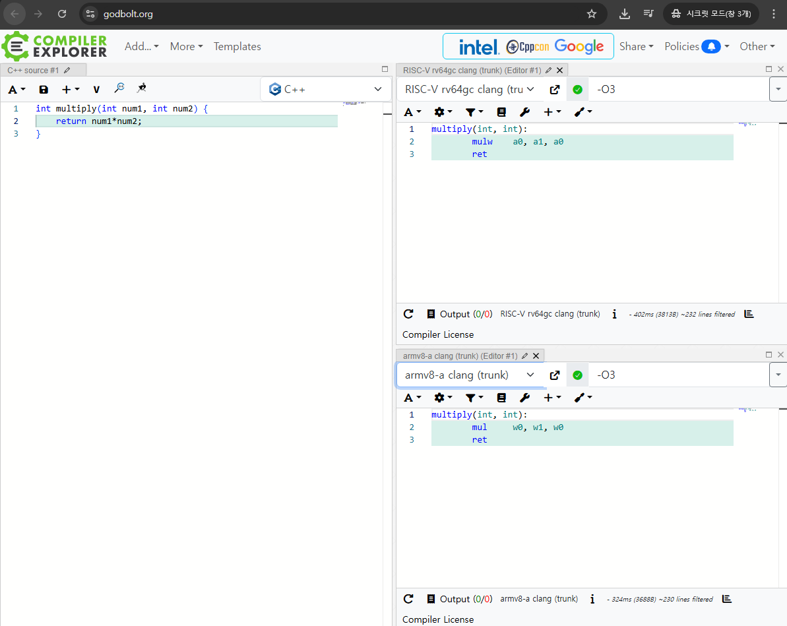
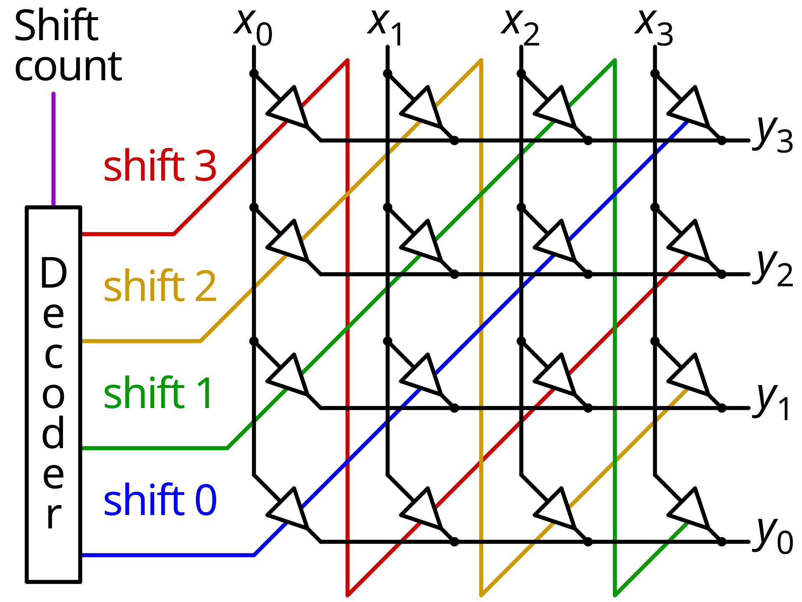

# 비트시프트 연산자의 우항에 음수가 들어가면 어떻게 될까

## 비트시프트란

비트시프트 (일반적으로 `>>`, `<<`로 표기됨) 연산자는 정수나 비트셋 등을 원하는 비트만큼 우측이나 좌측으로 밀어내는 _(Shift)_ 연산자이다.

```C++
int x = 10;      // 0b00001010
x <<= 2;         // 0b00101000
std::cout << x ; // 40
```

2진법을 사용하는 컴퓨터에서는 비트시프트의 의미가 2^n 만큼을 곱하거나 나눈 것과 같은 의미를 지닌다. 그리고 단순히 메모리의 비트를 옮기는 뿐인 작업이기 때문에 곱셈이나 나눗셈보다 CPU에서 훨씬 빠르게 동작한다. 

그래서 컴파일러는 2, 3으로 곱하거나 나누는 코드를 컴파일하면 비트시프트와 덧, 뺄셈을 혼합한 연산 등을 사용하는 트릭 등으로 코드를 최적화하기도 한다.

## 컴파일러에서 최적화를 위해 비트시프트를 사용하는 경우

소개에 앞서 어셈블리로 빌드된 코드를 보기 위한 유용한 [웹 사이트 (godbolt)](https://godbolt.org/)를 소개한다.



여러 타겟을 가진 다양한 버전의 컴파일러들을 다양한 언어로부터 빌드해서 결과를 확인할 수 있도록 해주는 웹 사이트로, 컴파일러나 디버거 설치 없이도 쉽게 어셈블리를 확인하고 실행해볼 수 있다.

### 3으로 나누기 최적화

다음은 3으로 나누는 프로그램이 실제로 컴파일되었을 때 CPU 내부에서 어떤 명령어로 동작하는지를 보여준다.

- C 소스
```C++
int divideby3(int num) {
    return num / 3;
}
```
- 어셈블리 소스 (ARMv8a) (최적화 없음)
```asm
divideby3(int):
        sub     sp, sp, #16
        str     w0, [sp, #12]
        ldr     w8, [sp, #12]
        mov     w9, #3
        sdiv    w0, w8, w9
        add     sp, sp, #16
        ret
```
최적화하지 않은 어셈블리는 `sdiv`명령어로 정직하게 `w9` 레지스터 (3이 저장됨)로 `w8`레지스터를 나누는 것을 확인할 수 있다.

- 어셈블리 소스 (ARMv8a) (최적화)
```asm
divideby3(int):
        mov     w8, #21846
        movk    w8, #21845, lsl #16
        smull   x8, w0, w8
        lsr     x9, x8, #32
        add     x0, x9, x8, lsr #63
        ret
```
최적화되어 컴파일된 경우 어셈블리에서는 `21846`과 `21845`라는 알기 어려운 매직 넘버와, `lsl`, `lsr`과 같은 논리 시프팅 연산을 함께 사용하고, 나눗셈 하나 없이 정수 곱셈도 함께 사용하고 있다.

간략하게 설명하자면, 나눗셈 연산을 사용하는 대신, `1,431,655,765`라는 (`0x55555556`) 값을 곱하고 (`(2^32+2)/3+1` 인 값이다.), 오른쪽으로 32칸 shift해서 나눗셈 결과를 구하는 방법이다. 물론 아무 값이나 되는 경우는 아니고, 나누는 값을 정확히 알 수 있어 컴파일 시점에서 위와 같이 최적화할 수 있는 것이다.

> int가 아닌 long 값으로 바꾸거나, divider가 변수가 되면 얄짤없이 div 연산을 어셈블리단에서 사용한다.

### 5로 곱하기 최적화

더욱 단순한 예제로, 5로 곱셈하는 경우를 살펴보자

- C 소스
```C++
int multiplyby5(int num) {
    return num * 5;
}
```

- 어셈블리 소스 (RISC-V) (최적화)
```asm
multiplyby5(int):
        slli    a5,a0,2
        add     a0,a5,a0
        ret
```
> 최적화 없는 버전은 위 예제와 같이 비트시프트 연산으로 최적화되어버려서 별도로 싣지 않았다. 변수로 곱하는 경우, `mulw` 연산을 사용하는 것이 기본이다.
>
> 이 정도 수준의 단순한 최적화는 `-O0` 옵션을 주더라도 최적화하는 것으로 보인다.

위 어셈블리 소스를 보면, `a0` 레지스터(`num`)를 좌측으로 2칸 shift하고(`slli`), 그 값에 `a0`을 한 번 더 더해서 반환하는 것을 확인할 수 있다. 5의 2진수 표현이 `0b101`이므로, 곱셈을 수행할 때 곱해지는 수를 왼쪽으로 2칸 shift한 값과, 0칸 shift한 값(shift 하지 않음)을 더하면 5로 곱하는 것과 같은 식을 얻을 수 있고, shift해서 더하는 갯수가 많지 않으므로 `mul`을 사용하는 것보다 빠르게 구할 수 있기에 위와 같이 최적화 되었다.

만약 곱하는 수에 1이 많아지면, 필요한 클럭 수를 비교해서 더 빠른 쪽으로 최적화 될 것이다.

- C 소스
```C++
int multiplyby4564561(int num) {
    return num * 4564561;
}
```

- 어셈블리 소스 (RISC-V) (최적화)
```asm
multiplyby4564561(int):
        lui     a1, 1114
        addi    a1, a1, 1617
        mulw    a0, a0, a1
        ret
```
컴파일러가 스스로 필요 시간을 비교해서 적절하게 최적화하고 있다.

## CPU에서는 비트시프트 연산을 어떻게 구현할까

CPU에서는 [배럴 시프터(Wikipedia)](https://en.wikipedia.org/wiki/Barrel_shifter)를 사용해서 구현하는 것으로 알려져 있다.


[이미지 소스](https://en.wikipedia.org/wiki/Barrel_shifter#/media/File:Crossbar_barrel_shifter.svg)

위 이미지에서는 비효율적이게도 정수가 32비트라면, 나올 수 있는 총 개수인 31개로 디코딩해서 회로단에서 해당하는 갯수만큼 1칸 shift를 진행하는 것처럼 나와있다. (배럴 시프터의 간단한 예시이다.)

실제로 구현되는 것은 정수가 32비트라면, 16, 8, 4, 2, 1비트를 시프팅하는 시프터가 하드웨어에 구현되어있고, shift하는 값의 하위 5비트 값의 시프터를 사용해 값 시프팅을 한 CPU 사이클 안에 수행하게 된다.

```Verilog
module barrel_shifter_4bit (
    input [3:0] data_in,      // 4-bit input data
    input [1:0] shift_amount, // 2-bit shift amount (0 to 3)
    output [3:0] data_out    // 4-bit output data
);

    wire [3:0] s1_out; // Output after 1-bit shift stage
    wire [3:0] s2_out; // Output after 2-bit shift stage

    // Stage 1: Shift by 1 bit (if shift_amount[0] is 1)
    // shift_amount[0] = 1이면 1칸 시프트, 아니면 그대로 통과
    assign s1_out = shift_amount[0] ? (data_in >> 1) : data_in;

    // Stage 2: Shift by 2 bits (if shift_amount[1] is 1)
    // shift_amount[1] = 1이면 2칸 시프트, 아니면 그대로 통과
    // Stage 1의 결과(s1_out)를 입력으로 받음
    assign s2_out = shift_amount[1] ? (s1_out >> 2) : s1_out;

    // Final output
    assign data_out = s2_out;

endmodule
```

## 우항에 음수가 들어가면 어떻게 될까

> 언어마다 처리하는 방법이 다르다.

### Python

Python은 비트시프트 연산자의 우항에 음수가 들어가는 것을 허용하지 않는다.
```bash
Python 3.11.9 (tags/v3.11.9:de54cf5, Apr  2 2024, 10:12:12) [MSC v.1938 64 bit (AMD64)] on win32
Type "help", "copyright", "credits" or "license" for more information.
>>> 3 << -1
Traceback (most recent call last):
  File "<stdin>", line 1, in <module>
ValueError: negative shift count
```

### Java

Java는 우항에서 음수를 사용할 수 있다. 다음은 예제와 실행 결과이다.
- Java 코드
```java
public class Test
{
	public static int shl(int num) {
		return 1<<num;
	}
	public static int shr(int num) {
		return 1>>num;
	}
	public static void main(String args[]) throws Exception
	{
		for(int i=0;i<32;i++) {
			System.out.println("1 << -"+i+" = "+shl(-i)+", 1 >> "+i+" = "+shr(i));
		}
	}
}
```
- 실행 결과
```
1 << -0 = 1, 1 >> 0 = 1
1 << -1 = -2147483648, 1 >> 1 = 0
1 << -2 = 1073741824, 1 >> 2 = 0
1 << -3 = 536870912, 1 >> 3 = 0
1 << -4 = 268435456, 1 >> 4 = 0
1 << -5 = 134217728, 1 >> 5 = 0
1 << -6 = 67108864, 1 >> 6 = 0
1 << -7 = 33554432, 1 >> 7 = 0
1 << -8 = 16777216, 1 >> 8 = 0
1 << -9 = 8388608, 1 >> 9 = 0
1 << -10 = 4194304, 1 >> 10 = 0
1 << -11 = 2097152, 1 >> 11 = 0
1 << -12 = 1048576, 1 >> 12 = 0
1 << -13 = 524288, 1 >> 13 = 0
1 << -14 = 262144, 1 >> 14 = 0
1 << -15 = 131072, 1 >> 15 = 0
1 << -16 = 65536, 1 >> 16 = 0
1 << -17 = 32768, 1 >> 17 = 0
1 << -18 = 16384, 1 >> 18 = 0
1 << -19 = 8192, 1 >> 19 = 0
1 << -20 = 4096, 1 >> 20 = 0
1 << -21 = 2048, 1 >> 21 = 0
1 << -22 = 1024, 1 >> 22 = 0
1 << -23 = 512, 1 >> 23 = 0
1 << -24 = 256, 1 >> 24 = 0
1 << -25 = 128, 1 >> 25 = 0
1 << -26 = 64, 1 >> 26 = 0
1 << -27 = 32, 1 >> 27 = 0
1 << -28 = 16, 1 >> 28 = 0
1 << -29 = 8, 1 >> 29 = 0
1 << -30 = 4, 1 >> 30 = 0
1 << -31 = 2, 1 >> 31 = 0
1 << -32 = 1, 1 >> 32 = 1
```
특이한 점은, `<<`에서 음수값을 시프팅하는 것이 결코 `>>`와 동치가 아니라는 점이다. 0이 되는 것이 아니라, LSB에 있던 비트가 MSB로 이동했다.

`>>` 연산도 이상한 점은, 1~31까지의 값을 오른쪽으로 비트시프팅을 수행했을 때에는 0이 되지만, 32만큼을 시프팅한 경우 원래 값으로 돌아왔다.

좌항에 3을 넣어보면 이 원리를 조금은 추측해볼 수 있다.

- java 코드
```java
public class Test
{
	public static int shl(int num) {
		return 3<<num;
	}
	public static int shr(int num) {
		return 3>>num;
	}
	public static void main(String args[]) throws Exception
	{
		for(int i=0;i<=32;i++) {
			System.out.println("3 << -"+i+" = "+shl(-i)+", 3 >> "+i+" = "+shr(i));
		}
	}
}
```
- 실행 결과
```
3 << -0 = 3, 3 >> 0 = 3
3 << -1 = -2147483648, 3 >> 1 = 1
3 << -2 = -1073741824, 3 >> 2 = 0
(중략)
3 << -31 = 6, 3 >> 31 = 0
3 << -32 = 3, 3 >> 32 = 3
```
`3 << -1` 한 경우, MSB와 LSB에만 true인 비트가 남아 `-2147483647`가 나와야 한다고 생각할 수 있지만, `1 << -1`과 같은 `-2147483648`값이 나오는 것을 확인할 수 있다.

다음의 코드를 보면 상당히 비직관적인 결과물을 출력하고 있음을 알 수 있다.
- java 코드
```java
public class Test
{
	public static void main(String args[]) throws Exception
	{
		System.out.println((3<<-1)==(1<<-1));

		System.out.println((1<<-1)<<1);
		System.out.println(1<<(-1+1));

		System.out.println((3<<-1)<<1);
		System.out.println(3<<(-1+1));
	}
}
```
- 실행 결과
```
true
0
1
0
3
```
이런 결과를 내는 이유는 위에서 설명한 CPU 하드웨어에서의 비트시프트연산의 처리 방법과 관련있다. JAVA VM은 CPU에서 시프트 연산을 처리하는 것처럼 int는 우항의 하위 5비트를, long은 우항의 하위 6비트만을 사용하여 각각 0~31, 0~63의 값만 사용하도록 [JAVA 문서에서 정의하고 있다.](https://docs.oracle.com/javase/specs/jls/se25/html/jls-15.html#jls-15.19)

> If the promoted type of the left-hand operand is int, then only the five lowest-order bits of the right-hand operand are used as the shift distance. It is as if the right-hand operand were subjected to a bitwise logical AND operator & (§15.22.1) with the mask value 0x1f (0b11111). The shift distance actually used is therefore always in the range 0 to 31, inclusive.
>
> If the promoted type of the left-hand operand is long, then only the six lowest-order bits of the right-hand operand are used as the shift distance. It is as if the right-hand operand were subjected to a bitwise logical AND operator & (§15.22.1) with the mask value 0x3f (0b111111). The shift distance actually used is therefore always in the range 0 to 63, inclusive.

따라서 `-1`은 우항에서 읽어낼 때 `31` 값으로 읽히고, 3을 31칸 왼쪽으로 비트시프팅하는 경우 1번째 비트는 오버플로되어 사라지고 0번째 비트만 31번째 비트만 남아 정수의 음수 표기 방법에 따라 `-2147483648` 값을 가지게 된다.

### C, C++

C와 C++에서는 Undefinded Behavior로 규정하고 있다. 다음의 코드는 최적화 옵션에 따라 다른 값을 보인다. (물론 Warning이 나온다.)

- C++ 코드
```c++
#include <iostream>
using namespace std;
int main(){
    cout<<(1<<-1);
}
```

- 실행 결과 (`-O1` 최적화)
```
<source>: In function 'int main()':
<source>:4:13: warning: left shift count is negative [-Wshift-count-negative]
    4 |     cout<<(1<<-1);
      |            ~^~~~
ASM generation compiler returned: 0
<source>: In function 'int main()':
<source>:4:13: warning: left shift count is negative [-Wshift-count-negative]
    4 |     cout<<(1<<-1);
      |            ~^~~~
Execution build compiler returned: 0
Program returned: 0
0
```

- 실행 결과 (`-O0` 최적화)
```
<source>: In function 'int main()':
<source>:4:13: warning: left shift count is negative [-Wshift-count-negative]
    4 |     cout<<(1<<-1);
      |            ~^~~~
ASM generation compiler returned: 0
<source>: In function 'int main()':
<source>:4:13: warning: left shift count is negative [-Wshift-count-negative]
    4 |     cout<<(1<<-1);
      |            ~^~~~
Execution build compiler returned: 0
Program returned: 0
-2147483648
```

두 개의 어셈블리 코드를 비교해 보면, 최적화 옵션을 켠 경우에는 비트시프트 연산을 컴파일러가 컴파일 타임에 계산하면서 `0`을 출력했고, 최적화 옵션을 켜지 않은 경우에는 CPU의 비트시프트 연산을 사용하여 JAVA와 같은 `-2147483648`이 출력되었다. 함수로 처리할 때에는 최적화 옵션에 관계 없이 `-2147483648`이 나올 것이다.

물론 위 실행결과의 예제는 x86 CPU의 경우로 CPU 아키텍처나 설계 방법, 명령어의 동작 방법에 따라서 결과가 다를 수 있다.

### 결론

- 비트시프트 연산의 우항에 음수가 들어가지 않도록 주의하자.

| 언어 | 동작 |
| ---- | ---- |
| Python | 오류 |
| JAVA | 우항의 정수 표현의 마지막 5 / 6비트만 사용 |
| C, C++ | UB, 컴파일러 / 하드웨어 구현에 따라 다름 |

## 비고

이 문서에서는 어셈블리와의 비교를 위해 [compiler-explorer](https://github.com/compiler-explorer/compiler-explorer) 프로젝트를 사용하였다. 해당 프로젝트의 웹 배포 버전은 [godbolt.org](https://godbolt.org/)에서 확인할 수 있다.

#Assembly #CS #컴퓨터구조